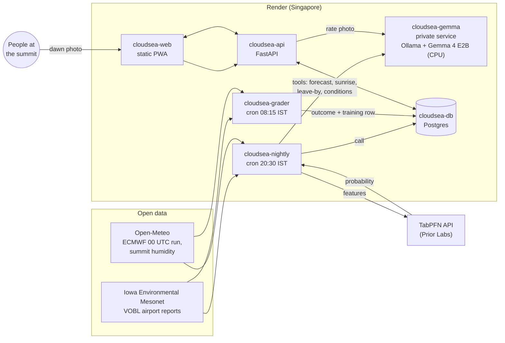

# CloudSea

**Tomorrow's sunrise call for Nandi Hills: GO, MAYBE or SKIP, published at 8:30 PM, graded in public every morning.**

Every weekend thousands of people in Bangalore set a 3:30 AM alarm and ride to Nandi Hills hoping to stand above a sea of clouds at sunrise. Many find haze or a clear view of the plains instead. CloudSea makes the call the night before: the chance of a cloud sea, sunrise time, when to leave your area, and what to carry. One glance, then sleep.

- Live app: https://cloudsea-web.onrender.com
- How it works and the backtest: https://cloudsea-web.onrender.com/#/how
- Build log, with every decision, dead end and number: [BUILD_LOG.md](BUILD_LOG.md)

## How it works



1. **Label.** "Cloud sea at Nandi" is defined from the airport's dawn reports plus humidity at summit height (`cloudsea/label.py`). It was checked against 31 dated summit photos: when the airport rule said "sea", the photos agreed 5 times out of 6.
2. **Forecast.** TabPFN uses only what exists by 8:30 PM: airport reports to 19:30 IST and the 00 UTC ECMWF run of that day. An automated leakage test guards this.
3. **Call.** Gemma 4 calls four tools and writes the call in four short sentences. A guardrail checks that every number comes from a tool result; otherwise it retries, then falls back to a template. Kannada and Hindi versions pass a similar check before they're shown.
4. **Photos.** People at the top upload one photo, which is resized on the phone. The app checks the EXIF time and place, then removes all metadata before storing it. Gemma rates the photo and the uploader confirms the rating with one tap. Photos are private unless shared.
5. **Grading.** Every morning the grader scores the call against the airport and the photos, then adds the day to the training data.

## Results (backtest, 2025-26 fog season, 151 nights)

| | Brier | ROC-AUC |
|---|---|---|
| TabPFN, airport + ECMWF (live model) | 0.147 | 0.87 |
| Gradient-boosted tree, airport + ECMWF | 0.144 | 0.87 |
| Monthly climatology | 0.204 | 0.70 |
| ECMWF raw low cloud | 0.398 | 0.55 |

Going on all 43 weekend mornings would have found 17 cloud seas. Going only on GO: 12 trips, 10 cloud seas. Earlier seasons were harder: out-of-fold AUC for the live model was 0.72, 0.55 and 0.74. Details and charts: [docs/results/](docs/results/), [BUILD_LOG.md](BUILD_LOG.md).

## Run it locally

Needs [uv](https://docs.astral.sh/uv/), Node 20, Docker and [Ollama](https://ollama.com) (0.30.9 or newer).

```sh
git clone https://github.com/vineetjk/CloudSea && cd CloudSea
cp .env.example .env              # add TABPFN_TOKEN (platform.priorlabs.ai)
make setup                        # Python 3.12 env + pre-commit secret check
make gemma-pull                   # gemma4:e2b-it-q4_K_M (4.6 GB) + test photos
make db-up                        # local Postgres in Docker
make nightly                      # tonight's call into the local database
make api                          # API on :8000
cd web && npm ci && npm run dev   # app on :5173 (proxies to the API)
```

`make help` lists every step: data downloads, the label report, the backtest, the benchmarks and tests. `make test-db` runs everything, including the Postgres tests.

## Deploy

One Blueprint: in the Render Dashboard choose **New → Blueprint** and point it at this repo. `render.yaml` creates the web app, API, the private Gemma service with its disk, the two cron jobs and Postgres, all in Singapore. You'll be asked for `TABPFN_TOKEN`. At the listed plans it costs about $152 a month; see the comments in `render.yaml`. `scripts/render_deploy.py` does the same through the Render API.

## Licences and attribution

- **Code:** Apache 2.0 ([LICENSE](LICENSE)).
- **Gemma 4** (Google) is used under Apache 2.0 through [Ollama](https://ollama.com/library/gemma4). See the [Gemma 4 model card](https://huggingface.co/google/gemma-4-E2B-it) and technical report.
- **TabPFN** is used through Prior Labs' hosted API (`tabpfn-client`, Apache 2.0) under the [Prior Labs terms](https://priorlabs.ai/terms). Only weather features and labels are sent, with no personal data. Hollmann et al., "Accurate predictions on small data with a tabular foundation model", *Nature* 2025.
- **Airport reports:** the Iowa Environmental Mesonet ASOS/METAR archive, Iowa State University.
- **Weather data by [Open-Meteo.com](https://open-meteo.com/)** (CC BY 4.0), including ECMWF IFS model data.
- **Drive times:** [OSRM](https://project-osrm.org/) on [OpenStreetMap](https://www.openstreetmap.org/copyright) data (ODbL).
- **Sunrise:** [astral](https://github.com/sffjunkie/astral) (Apache 2.0).
- **Font:** Inter (SIL OFL 1.1), `cloudsea/assets/Inter-OFL.txt`.
- **Test and reference photos** come from Wikimedia Commons under CC BY-SA. They're downloaded on demand and not stored in this repo; credits are in `docs/phase1/commons_dawn_index.json` and in the `ATTRIBUTION.md` that `make gemma-pull` writes.

This is a forecast, not a guarantee. Check the gate time and the roads before you go, and never hurry on a hill road in the dark.
