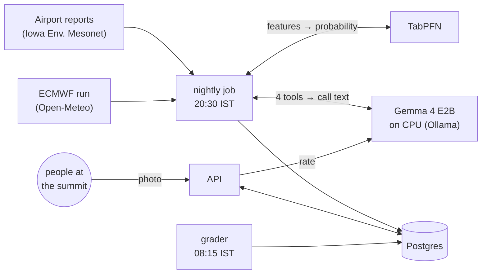

*This is a submission for the [Hacktoberfest Open-Source AI Challenge Week 1: Touch Grass](https://dev.to/challenges/hacktoberfest-week1-2026-10-05)*

## What I Built

Every weekend, thousands of people in Bangalore set an alarm for 3:30 AM and ride 60 km north to Nandi Hills. The hope is to stand at 1,478 m as the sun comes up over a sea of clouds, with the plains buried under white and only the neighbouring hilltops sticking out. Some mornings you get that. Many mornings you get grey haze, a clear view of fields, or fog so thick you can't see the railing. Whether it's worth going is a coin you toss at bedtime.

I live in Electronics City, 80 km and an hour and a half from the hill, so I can't go every weekend to find out. Instead I built **CloudSea**, which makes the call the night before and lets the people who *are* at the top tell it whether it was right.

At 8:30 PM every night CloudSea publishes **GO, MAYBE or SKIP** for tomorrow's sunrise, with the chance of a cloud sea, the sunrise time, when to leave your area, and what to carry. At sunrise, people at the summit can upload one photo; an open model rates it and they confirm the rating with one tap. At 8:15 AM the app grades its own call against the airport's dawn reports and those photos, in public.

*The live app on 10 Oct. The call shown is a daytime test run (issued 2:44 PM); the nightly job publishes the real one at 8:30 PM.*

## Demo

- **Live app:** https://cloudsea-web.onrender.com. Install it as a PWA on your phone.
- **How it works and the backtest:** https://cloudsea-web.onrender.com/#/how

The call is short enough to read half asleep, and it's written by Gemma in English, Kannada and Hindi:

Sharing is one tap. The server draws the card for WhatsApp and Instagram stories:

## How I Built It

Everything runs on **Render** in Singapore, from one `render.yaml` Blueprint:
- a static PWA and a FastAPI service;
- a **private service running Ollama with Gemma 4 on CPU**, with its weights on a persistent disk;
- two **cron jobs**, one at 8:30 PM for the call and one at 8:15 AM for grading;
- Postgres.

The cron jobs reach Gemma over Render's private network.

**TabPFN makes the forecast.** The training set is small: about 2,000 labelled days, and only two fog seasons have the forecast-model features that existed on the night. TabPFN is a tabular foundation model made for that size, with no tuning: rows in, probability out. It only sees what existed at 8:30 PM: airport reports up to 7:30 PM and the 00 UTC ECMWF run of that day. A test scrambles everything after the cut-off and fails if any feature changes. It caught a real bug when I moved the cut-off and forgot the rain window.

**Gemma 4 does four jobs with one small model.** It's the E2B variant at 4-bit, a 4.6 GB download:

1. **The call.** An agent with four tools (`get_forecast`, `get_sunrise`, `get_leave_by`, `get_conditions`) writes four short sentences.
2. **A guardrail on the call.** It checks every number against the tool results, *and that each number sits in the right place*. The sunrise time has to be in the sunrise sentence, the leave-by time in the leave sentence, and the probability on "chance of a cloud sea". A draft that fails is retried; after three failures a template goes out. The placement check came from reading [golden-hour: a go-outside planner where a small local Gemma cannot invent numbers](https://dev.to/sansk_ya/golden-hour-a-go-outside-planner-where-a-small-local-gemma-cannot-invent-numbers-3ol5) by @sansk_ya. It shows how "is this number somewhere in the facts" passes swapped values, and mine did too.
3. **Photo rating.** Gemma rates each summit photo into strict JSON: cloud sea, partial, clear, or socked in. It answers evidence questions first (are nearby trees hazy? is the ground visible below?), which took agreement with my reference labels from 3/11 to 7–8/11.
4. **Kannada and Hindi.** Every number must match the English before a translation is shown.

**Open data feeds it:**
- Airport reports for Kempegowda airport (VOBL) back to 2008, from the Iowa Environmental Mesonet.
- One archived ECMWF run per day since March 2024, from Open-Meteo.
- Drive times from OSRM on OpenStreetMap.

## Why open matters here

- **The model sits next to the data, with no per-token bill.** The whole stack is about $150 a month on Render, and most of that is the Gemma box. A nightly call takes 12 seconds on 2 CPUs.
- **When Gemma got something wrong, I could see exactly what it was sent and what it said back.** For a SKIP at 8% it once wrote "GO, 0%" three times in a row. The guardrail threw all three away. Reading the raw exchange is how I found the guardrail's own bug: the degree sign in "17°C" was escaped into a code ending in `00b0`, which quietly made "0" and "00" allowed numbers.
- **One small open model covers text, tool calls, vision and two Indian languages**, so one private service is enough.
- **Photos stay on my server.** They're private by default, and all EXIF, including GPS, is stripped before storage. No photo goes to a third-party model.

## The honest part: an airport is not a mountain top

There is no weather station on Nandi Hills. The nearest one that reports every half hour is the airport, 19 km away and 563 m lower. So "was there a cloud sea at Nandi at sunrise?" has to be estimated. I defined it as:
- at least two of the airport's dawn reports show fog, visibility under 1,500 m, or cloud at or below 1,000 ft;
- no rain;
- the air at summit height isn't saturated. This last part separates fog below you from standing inside the cloud.

Then I checked it against real photos. Wikimedia Commons has 94 photos of Nandi Hills whose camera clock says they were taken between 5 and 9 AM. On 31 of those mornings you can see the view below.
- When the airport rule said "sea", the photos agreed 5 times out of 6.
- It caught 5 of the 9 cloud seas in the photos.
- It never fired on the 6 mornings when the summit was inside the fog.

That's a small sample, labelled by me, so it's a sanity check, not proof.

The proxy can't see how thick the layer is, valley fog north of the hill, or fog that forms after 7:30. That's why the app collects summit photos and grades itself every morning against both the airport and the photos. Once two or more people agree on what they saw, their answer replaces the airport's in the training data.

## Results

**Backtest on the 2025-26 fog season.** The model never saw these 151 nights; there was a cloud sea on 35% of them.

| | Brier (lower is better) | ROC-AUC |
|---|---|---|
| TabPFN, airport + ECMWF (live model) | 0.147 | 0.87 |
| Gradient-boosted tree, airport + ECMWF | 0.144 | 0.87 |
| TabPFN, airport only | 0.177 | 0.80 |
| Gradient-boosted tree, airport only | 0.201 | 0.72 |
| Monthly climatology | 0.204 | 0.70 |
| Persistence (tomorrow = this morning) | 0.223 | 0.64 |
| Hand rule (moist, calm, clear evening) | 0.250 | 0.53 |
| ECMWF's raw dawn low-cloud forecast | 0.398 | 0.55 |

**Going on all 43 Saturday and Sunday mornings would have meant 43 trips and 17 cloud seas. Going only when CloudSea said GO: 12 trips and 10 cloud seas.** Staying home on SKIP would have missed 1.

What I didn't expect:

- **TabPFN and the gradient-boosted tree tie once the forecast-model features are in.** TabPFN's advantage shows where data is thin. Season by season, each season predicted only from earlier data, it had the better Brier score every time (0.208 vs 0.260 in 2022-23, trained on 547 rows).
- **The latest season was the easy one.** Earlier seasons scored AUC 0.72, 0.55 and 0.74, so I expect live skill below the headline.
- **The probabilities are a bit timid.** Nights it gave 10–30% had a cloud sea only 3–7% of the time, and all 14 nights it put above 80% had one.

**Gemma 4 E2B, same model and prompts on both machines:**

| | MacBook M2, 8 GB (Metal) | Render 2c-8g (CPU) | Render 4c-8g (CPU) |
|---|---|---|---|
| Generation | 22–28 tokens/s | 6.1 tokens/s | 6.4 tokens/s |
| Nightly call (agent, 4 tools) | 2–3 s | 11.8 s | 10.9 s |
| Rate one photo | ~4 s | 29.8 s | 30.3 s |
| Cost | the laptop | $135/month | $175/month |

Doubling the cores bought 5%, so the cheaper box is the right one.

## Taking it outside, remotely

I couldn't get to the hill this weekend, and the app went live the day before the deadline, so nobody has used it at the summit yet. Instead I tested it against people who had already been up there and shared their photos.

Wikimedia Commons has Nandi Hills photos whose camera clock places them at dawn. For 30 mornings between 2012 and 2020 you can see what the view below looked like. I ran CloudSea's model on each of those mornings, using only the airport reports from the evening before. It was the airport-only version, because the archived ECMWF runs start in 2024, and it was trained only on 2021–2025, so it had never seen any of these days.

- It ranked the mornings well enough to be useful: **ROC-AUC 0.71**. Cloud-sea mornings got 25% on average, the rest 12–15%.
- **It said GO once, and that morning was a cloud sea.** It never said GO on a clear morning or one inside the fog.
- **It missed 4 of the 10 cloud seas with a SKIP.** Most fell in months it treats as off-season (March, May, August). On one there was nothing at the airport at all, probably valley fog it can't see. That is the gap the photo uploads are meant to close.

|  |  |
|---|---|
| **6 Jan 2017**, cloud sea. CloudSea: **GO, 67%**. *[Photo](https://commons.wikimedia.org/wiki/File:Nandi_Hills,_Bangalore.jpg) by RITWIK J, [CC BY-SA 4.0](https://creativecommons.org/licenses/by-sa/4.0)* | **13 Jan 2019**, cloud sea. CloudSea: **MAYBE, 48%**. *[Photo](https://commons.wikimedia.org/wiki/File:Nandi_Hills,_Bengaluru.jpg) by Sidhant Soni, [CC BY-SA 4.0](https://creativecommons.org/licenses/by-sa/4.0)* |
|  |  |
| **6 Mar 2016**, cloud sea. CloudSea: **SKIP, 11%**, a miss. *[Photo](https://commons.wikimedia.org/wiki/File:Sun_rising_over_a_blanket_of_clouds,_Nandi_Hills,_Karnataka.jpg) by Sri chakra pranav, [CC BY-SA 4.0](https://creativecommons.org/licenses/by-sa/4.0)* | **7 Jun 2016**, inside the fog. CloudSea: **SKIP, 2%**. *[Photo](https://commons.wikimedia.org/wiki/File:Nandi_hills,_Karnataka.jpg) by Shravan Kamath94, [CC BY-SA 4.0](https://creativecommons.org/licenses/by-sa/4.0)* |

**This morning, 10 Oct.** Using only the evening of 9 Oct, the live model (airport + ECMWF) says **SKIP, 7%**. The grader, run this afternoon on this morning's airport reports, says **no cloud sea**: visibility 4 km in mist, no low ceiling, summit-level humidity 64%. One real call, and it was right. The first scheduled call goes out at 8:30 PM tonight, and the scoreboard at https://cloudsea-web.onrender.com/#/scoreboard fills from 8:15 AM tomorrow, right or wrong.

## Things that went wrong

- **A sentence can be numerically right and still wrong.** One draft said "Leave Electronics City by 03:40 from the parking area". Gemma had pulled "parking" from the what-to-carry list. The prompt now fixes the order of four sentences.
- **Translation needed a glossary.** Without one, Gemma's Kannada turned "cloud sea" into "cloudy weather" and read "Sun" (Sunday) as "evening".
- **Visibility in miles.** The archive stores visibility in statute miles, so a reported "1500 m" comes back as 1497 m and slipped under a "< 1500 m" rule. I found it by reading example days, not from a metric.
- **The forecast-model archive I first planned to use would have flattered the model.** Open-Meteo's historical-forecast API stitches together the first hours of each run, which is close to what actually happened. I switched to the archive of single runs, which only goes back to March 2024.

## Code

**https://github.com/vineetjk/CloudSea** (Apache 2.0)

- `make help` lists every step, from data download to backtest to deploy.
- 71 Python tests (label, leakage, guardrail, translation, EXIF stripping, API) and 24 frontend tests.
- [BUILD_LOG.md](https://github.com/vineetjk/CloudSea/blob/main/BUILD_LOG.md) has every decision, dead end and number with a timestamp.

## What's next

- Collect summit photos through the fog season and retrain on photo-confirmed labels.
- Web push for "GO tonight".
- More hills with the same problem: Skandagiri, Makalidurga.
- Check the Electronics City drive time and the gate opening time on a real trip. Both are marked as estimates in the app.

## AI assistance

I built this with Claude Code, an AI coding agent, as my pair. I wrote the brief and its rules: open models and open data doing the real work, no closed model APIs, no invented data, and an honest account of what the proxy can't see. The agent wrote much of the code, did much of the research, and proposed the cloud-sea label and the GO/SKIP thresholds from the data when I asked it to run every phase; the reasoning is in BUILD_LOG.md. Every number above comes from code in the repo.

*Partner tech: Gemma 4 (Google), TabPFN (Prior Labs), Render, Entire. Weather data by [Open-Meteo.com](https://open-meteo.com/); airport reports via the Iowa Environmental Mesonet. A forecast, not a guarantee.*
