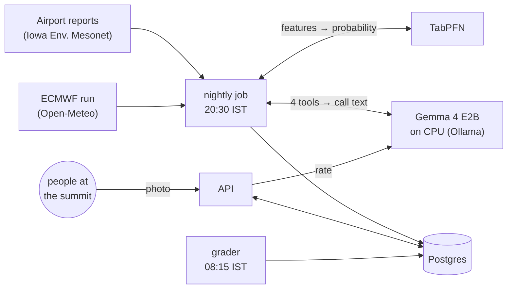
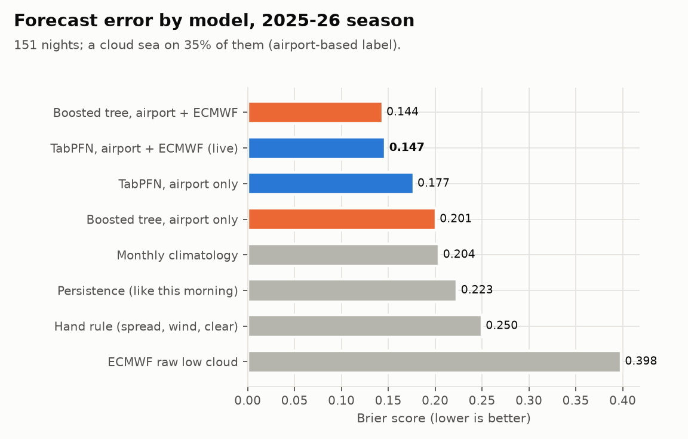
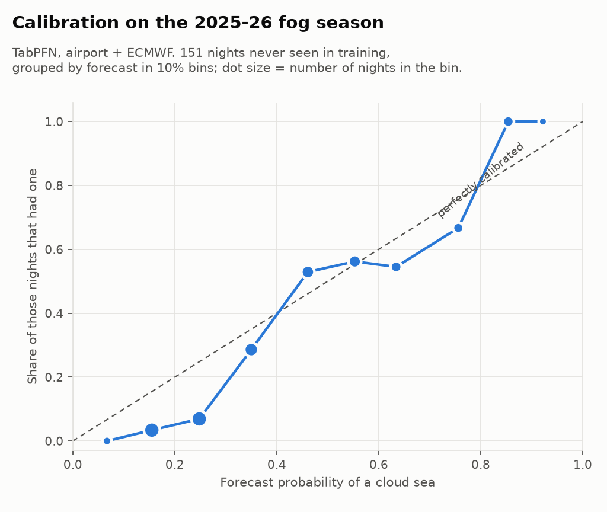
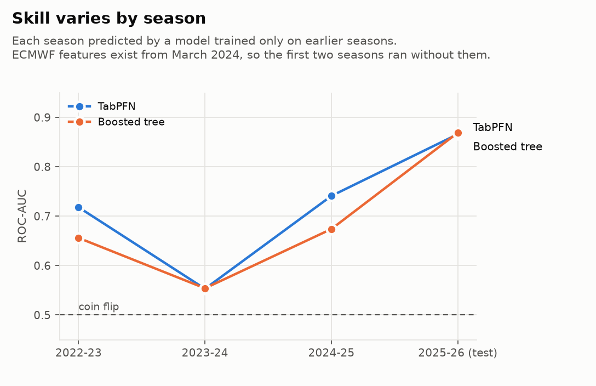

<!-- DRAFT. Replace every [PLACEHOLDER] with real material before publishing, and adapt the headings to the
submission template on the challenge page. Never fill a placeholder with an invented result. -->

## The 3:30 AM gamble

Every weekend, thousands of people in Bangalore set an alarm for 3:30 AM and ride 60 km north to Nandi Hills. The hope is to stand at 1,478 m as the sun comes up over a sea of clouds, with the plains buried under white and only the neighbouring hilltops sticking out. Some mornings you get that. Many mornings you get grey haze, a clear view of fields, or fog so thick you can't see the railing.

Whether it's worth going is a coin you toss at bedtime.

I live in Electronics City, about 80 km and an hour and a half from the hill. I can't go every weekend to find out what works. So I built CloudSea to make the call the night before, and to let the people who *are* at the top tell it whether it was right.

[PLACEHOLDER: one real story or photo from someone who used the call, once there is one.]

## What it does

At 8:30 PM every night, CloudSea publishes **GO, MAYBE or SKIP** for tomorrow's sunrise at Nandi Hills. The call comes with the chance of a cloud sea, the sunrise time, when to leave your area, and what to carry. At sunrise, people at the summit can upload one photo; an open model rates it and they confirm the rating with one tap. At 8:15 AM the app grades its own call against the airport's dawn reports and those photos, and puts the result on a public scoreboard.

[PLACEHOLDER: screenshot `docs/screenshots/home-light.png` (tonight's call), `docs/screenshots/og-2026-10-11.png` (the share card)]

Live: https://cloudsea-web.onrender.com · Code: https://github.com/vineetjk/CloudSea

## How the open pieces make it work

**TabPFN makes the forecast.** The training set is small: about 2,000 days with labels, and only two fog seasons where I have the forecast-model features that existed on the night (more on that below). TabPFN is a tabular foundation model built for exactly that size. There's no hyperparameter search; I give it the rows and it gives me a probability. On the 2025-26 season, which it never saw, its Brier score was 0.147, against 0.204 for "use the monthly average", and its ROC-AUC was 0.87. Of the 34 nights it would have said GO, 76% delivered a cloud sea.

**Gemma 4 writes the call, rates the photos, and translates.** One small open model, the E2B variant at 4-bit (a 4.6 GB download), does three jobs:

1. **The call.** An agent with four tools (`get_forecast`, `get_sunrise`, `get_leave_by`, `get_conditions`) writes four short sentences. Then a guardrail checks that every number in the text appears in a tool result, and that the call word, the probability and the leave-by time are all there. If a draft fails, Gemma gets another try; after three it falls back to a template.
2. **The photos.** Gemma rates each summit photo into strict JSON: cloud sea, partial, clear, or socked in.
3. **Kannada and Hindi.** The same model translates the call, behind the same kind of number check.

It runs on a CPU-only private service on Render. A nightly call takes 12 seconds, and rating a photo takes 30.

**Open data feeds it.** Airport weather reports for Kempegowda airport (VOBL) back to 2008 come from the Iowa Environmental Mesonet. Forecast-model data comes from Open-Meteo, including one archived ECMWF run per day since March 2024. Drive times come from OSRM on OpenStreetMap.

**Why open mattered here:**
- I could put the model next to the data, with no per-token bill. The whole stack is about $150 a month on Render, and most of that is the Gemma box.
- When Gemma got something wrong, I could see exactly what it was sent and what it said back, and fix the prompt. I didn't have to guess what a hosted endpoint was doing.
- One small open model covers text, tool calls, vision and two Indian languages. That made a single private service enough.
- Uploaded photos never leave my own server. Photos are private by default, and all EXIF (including GPS) is stripped before storage.

## The honest part: an airport is not a mountain top

There is no weather station on Nandi Hills. The nearest station that reports every half hour is the airport, 19 km away and 563 m lower. So "was there a cloud sea at Nandi at sunrise?" has to be estimated. I defined it as: at least two of the airport's dawn reports show fog, visibility under 1,500 m, or cloud at or below 1,000 ft, with no rain, and the air at summit height (850 hPa) isn't saturated. The last part separates "fog below you" from "you're standing inside the cloud".

Then I checked it against real photos. Wikimedia Commons has 94 photos of Nandi Hills whose camera clock says they were taken between 5 and 9 AM. On 31 of those mornings you can see the view below. When the airport rule said "sea", the photos agreed 5 times out of 6. It caught 5 of the 9 cloud seas in the photos. It never fired on the 6 mornings when the summit was inside the fog. One miss looks like valley fog that the airport simply can't see. It's a small sample, labelled by one person (me), so it's a sanity check, not proof.

What the proxy can't know: how thick the layer is, fog in the valleys north and west of the hill, fog that forms after 7:30, and haze that looks like a sea in photos. That gap is why the app collects summit photos and grades itself every morning against both the airport and the photos. Once two or more people agree on what they saw, their answer replaces the airport's in the training data.

## Results

**Backtest, 2025-26 fog season (151 nights, a cloud sea on 35% of them):**

| | Brier (lower is better) | ROC-AUC |
|---|---|---|
| TabPFN, airport + ECMWF (live model) | 0.147 | 0.87 |
| Gradient-boosted tree, airport + ECMWF | 0.144 | 0.87 |
| TabPFN, airport only | 0.177 | 0.80 |
| Gradient-boosted tree, airport only | 0.201 | 0.72 |
| Monthly climatology | 0.204 | 0.70 |
| Persistence (tomorrow = this morning) | 0.223 | 0.64 |
| Hand rule (moist, calm, clear evening) | 0.250 | 0.53 |
| ECMWF's raw dawn low-cloud forecast | 0.398 | 0.55 |

**Last season, going on all 43 Saturday and Sunday mornings would have meant 43 trips and 17 cloud seas. Going only when CloudSea said GO: 12 trips and 10 cloud seas.** Staying home on SKIP would have missed 1.

Three things I didn't expect:

- **TabPFN and the gradient-boosted tree tie once the forecast-model features are in.** TabPFN's advantage shows where data is thin. Season by season, each predicted only from earlier data, it had the better Brier score every time (0.208 vs 0.260 in 2022-23, trained on 547 rows).
- **The latest season was the easy one.** Earlier seasons scored AUC 0.72, 0.55 and 0.74, so I expect live skill below the headline.
- **The probabilities are a bit timid.** Nights it gave 10–30% had a cloud sea only 3–7% of the time; all 14 nights it put above 80% had one.

**Gemma 4 E2B, same model and prompts on both machines:**

| | MacBook M2, 8 GB (Metal) | Render 2c-8g (CPU) | Render 4c-8g (CPU) |
|---|---|---|---|
| Generation | 22–28 tokens/s | 6.1 tokens/s | 6.4 tokens/s |
| Nightly call (agent, 4 tools) | 2–3 s | 11.8 s | 10.9 s |
| Rate one photo | ~4 s | 29.8 s | 30.3 s |
| Cost | the laptop | $135/month | $175/month |

Doubling the cores bought 5%. The cheaper box is the right one.

**Live scoreboard:** [PLACEHOLDER: snapshot of https://cloudsea-web.onrender.com/#/scoreboard after the first graded mornings, Sun 11 and Mon 12 Oct. October is early in the fog season, so expect SKIPs; a SKIP that the airport and photos confirm is a real result.]

## Things that went wrong (and what caught them)

- **Gemma called a SKIP a GO.** In the first realistic test, for a SKIP at 8%, Gemma wrote "GO, 0%" three times in a row. The guardrail rejected every draft and the template went out. Looking closer, the guardrail had its own bug: the degree sign in "17°C" was escaped as `°`, which made "0" an allowed number. Both are fixed and tested.
- **A sentence can be numerically right and still wrong.** "Leave Electronics City by 03:40 from the parking area." Every number checked out. Gemma had pulled "parking" from the what-to-carry list. A number check can't catch that, so the prompt now fixes the order of four sentences.
- **Translation needed a glossary.** Without one, Gemma's Kannada turned "cloud sea" into "cloudy weather" and read "Sun" (Sunday) as "evening". Now a handful of fixed terms go in, the call word is handled in code, and a translation only appears if its numbers match the English.
- **The leakage test caught me.** I moved the airport cut-off from 20:00 to 19:30 because the archive runs 20–40 minutes late. The 24-hour rain window still ended at 20:00. The test scrambles everything after the cut-off and checks that no feature moves, and it failed straight away.
- **Visibility in miles.** The archive stores visibility in statute miles, so a reported "1500 m" comes back as 1497 m and slipped under a "< 1500 m" rule. I found it by reading example days, not from a metric.
- **The forecast-model archive I first planned to use would have flattered the model.** Open-Meteo's historical-forecast API stitches together the first hours of each model run, which is close to what actually happened. A model trained on it would look better in the backtest than it could ever be at 8:30 PM. I switched to the archive of single model runs, which only goes back to March 2024.

## What's next

- Collect summit photos through the fog season and retrain on photo-confirmed labels.
- Web push for "GO tonight".
- More spots with the same problem: Skandagiri, Makalidurga.
- A real check of the Electronics City drive time and the gate opening time. Both are shown as estimates or unverified.

## Links

- Live app: https://cloudsea-web.onrender.com
- Code (Apache 2.0): https://github.com/vineetjk/CloudSea
- Build log with every decision and number: https://github.com/vineetjk/CloudSea/blob/main/BUILD_LOG.md
- How I built it: [PLACEHOLDER: DevRelay agent-session embed / Entire checkpoint link]

I built this with an AI coding agent (Claude Code) as a pair. It did much of the typing and research; the decisions, the checks and the write-up are mine, and the full session is linked above.

Partner tech: Gemma 4 (Google), TabPFN (Prior Labs), Render, Entire. Weather data by [Open-Meteo.com](https://open-meteo.com/); airport reports via the Iowa Environmental Mesonet.
